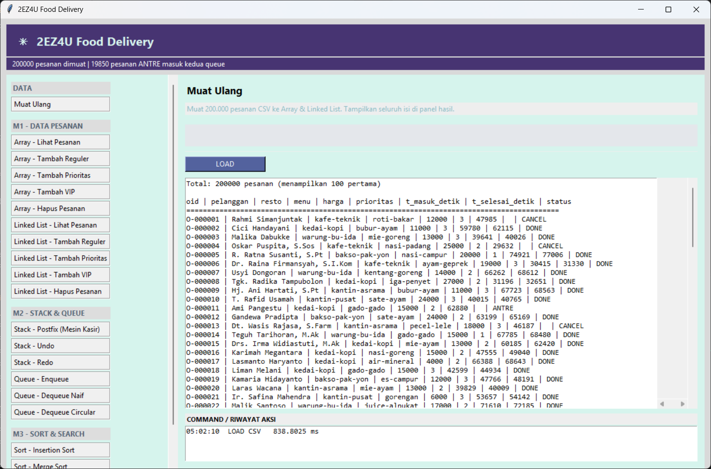
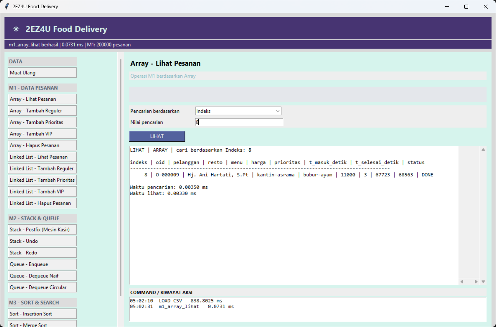
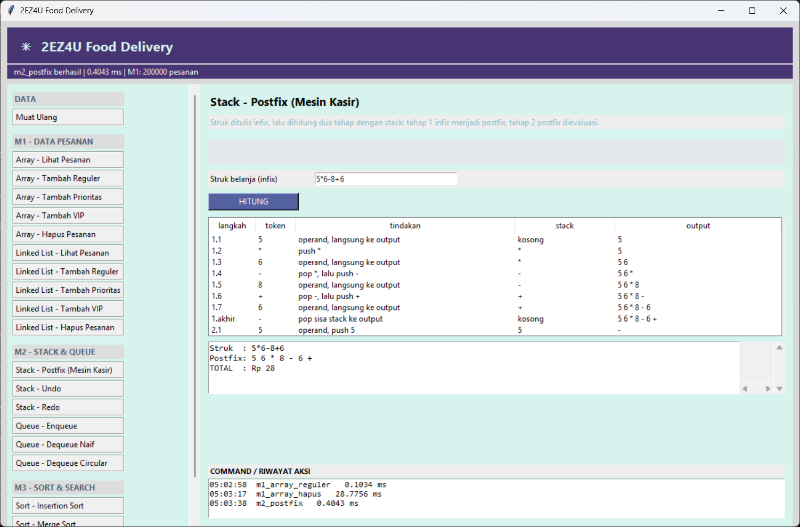
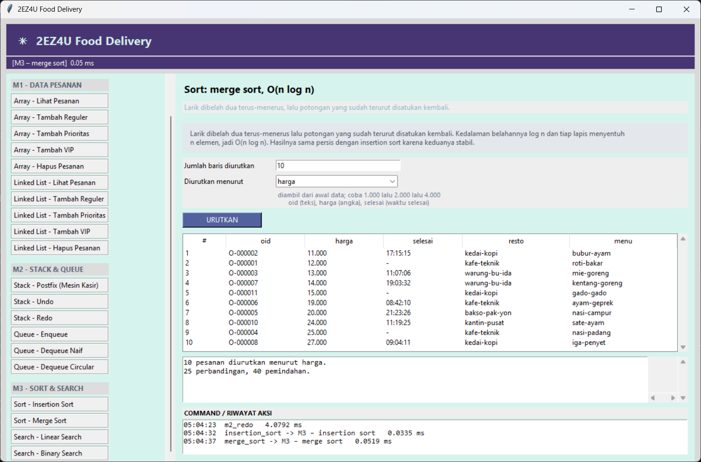

# 2EZ4U-APP
2EZ4U-APP merupakan project pengembangan aplikasi simulasi layanan pemesanan dan pengantaran makanan atau barang (delivery service) yang memiliki konsep serupa dengan GoFood, GrabFood, dan ShopeeFood, tetapi dalam versi yang lebih sederhana.

## Struktur Aplikasi 
1) Data : Menyimpan 200.000 data pesanan berbentuk CSV serta data peta
2) Backend : Menjalankan enam modul utama yang berisi implementasi struktur data dan algoritma
3) Frontend : Menampilkan antarmuka desktop sederhana menggunakan Tkinter

## Fitur Aplikasi
### M1 Array, Linked List
Pada M1 project 2EZ4U-APP berfokus pada implementasi struktur data Array dan Linked List untuk mengelola pesanan pada aplikasi layanan pengantaran makanan atau barang.
1) Array : Struktur data yang digunakan untuk menyimpan sekumpulan elemen secara berurutan dalam memori.
2) Linked List : Struktur data yang digunakan untuk menyimpan sekumpulan elemen dalam bentuk node yang saling terhubung melalui referensi atau pointer.

### M2 Stack & Queue
1) Stack-Undo : Stack Undo digunakan untuk membatalkan tindakan terakhir yang telah dilakukan pengguna sehingga sistem kembali ke kondisi sebelumnya. Setiap tindakan, seperti menambahkan atau mengeluarkan pesanan dari antrean, disimpan dalam stack. Ketika perintah Undo dijalankan, tindakan terakhir diambil menggunakan operasi pop() kemudian dibatalkan dengan menjalankan operasi kebalikannya.
2) Stack-Redo : Stack Redo digunakan untuk mengulangi tindakan yang sebelumnya telah dibatalkan menggunakan Undo. Ketika Undo dilakukan, tindakan yang dibatalkan akan disimpan dalam Stack Redo. Jika pengguna menjalankan Redo, tindakan tersebut diambil menggunakan pop() dan dijalankan kembali seperti semula.
3) Queue-Enqueue : Operasi untuk menambahkan data atau pesanan baru ke bagian belakang antrean (rear).
4) Queue-Dequeue Naif : operasi untuk mengeluarkan data atau pesanan dari bagian depan antrean (front) menggunakan array biasa.
5) Queue-Dequeue Circular : Operasi untuk mengeluarkan data dari bagian depan antrean menggunakan struktur Circular Queue atau antrean melingkar. Ketika penunjuk mencapai akhir array, posisinya dapat kembali ke indeks awal menggunakan operasi modulo.

### M3 Sort & Search 
1) Sort-Insertion Sort : Algoritma pengurutan yang bekerja dengan mengambil satu elemen, kemudian membandingkannya dengan elemen sebelumnya untuk menentukan posisi yang tepat. Jika elemen sebelumnya lebih besar, elemen tersebut akan digeser ke kanan hingga data tersusun secara berurutan. 
2) Sort-Merge Sort : Algoritma pengurutan yang menggunakan metode divide and conquer, yaitu membagi data menjadi dua bagian secara berulang hingga setiap bagian hanya memiliki satu elemen. Setelah itu, setiap bagian digabungkan kembali secara terurut hingga seluruh data tersusun dengan benar.
3) Search-Linear Search : Algoritma pencarian yang bekerja dengan memeriksa setiap elemen secara berurutan dari awal hingga data yang dicari ditemukan atau seluruh elemen telah diperiksa.
4) Search-Binary Search : Algoritma pencarian yang bekerja dengan membagi ruang pencarian menjadi dua bagian secara berulang. Algoritma ini membandingkan data yang dicari dengan elemen tengah, kemudian melanjutkan pencarian pada bagian kiri atau kanan sesuai hasil perbandingan.

## Teknologi yang digunakan
1. Python 3.11 : Bahasa pemrograman
2. Tkinter : Pembuatan UI

## Lampiran 

